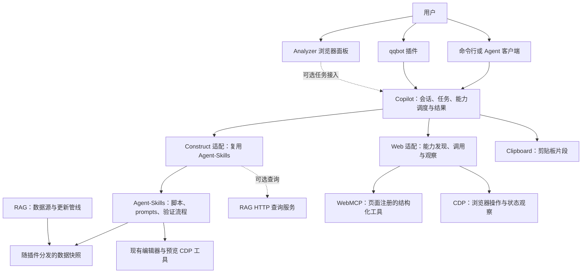

# Copilot 定位与仓库协作草案

Copilot 的目标是为 AI 使用 Web 提供能力接入与任务执行支持，并把 Construct 生态的工具组织成可验证的工作流。Construct 是首个完整应用场景，qqbot 和浏览器面板是使用入口。

本文是架构建议。现状与探测记录基于 2026-10-16 的本地仓库；目标接口和接入步骤尚待实现。

## 1. 核心边界

Copilot 负责发现能力、传递上下文、调度执行和汇总结果。领域规则由提供能力的仓库维护。一次任务应能回答：用了哪个工具版本、修改了哪个项目、实际执行到哪一步、留下了什么产物，以及失败发生在哪里。

目标分工如下：

实线与虚线均表达目标职责，不表示已经建立连接。Analyzer 保留独立的本地推理流程；是否把任务交给 Copilot，由它的产品流程决定。

“插件”需要区分三种含义：Copilot 的运行时扩展、Agent-Skills 的客户端分发包装，以及 Construct 编辑器里的对象或行为 addon。它们的清单与生命周期不同。

Skill 提供操作指令和工具用法；可执行脚本提供具体能力；插件包装负责客户端安装和发现。加载了 skill，不代表获得了一个可远程调用的服务。

## 2. Agent-Skills 是 Construct 执行能力的维护位置

[Agent-Skills 的仓库拆分决策](https://github.com/XHXIAIEIN/Construct3-Agent-Skills/blob/main/docs/decisions/plugin-repository.md)明确：

- `plugin/` 保存 skill、prompts、脚本、菜单、插件清单和客户端代理类型的源码。
- RAG 保存原始数据、数据更新管线和可选 HTTP 查询服务。
- `scripts/build_plugin.py` 从 RAG 构建 `plugin/data/`。分发的插件带有数据快照，运行时可以直接读取它。
- Manual 和官方示例等仓库提供补充资料。Agent-Skills 已有查找这些相邻仓库的逻辑。

因此，Copilot 应直接调用 Agent-Skills 的能力，由 Agent-Skills 维护 Construct 的操作流程和编辑器规则。一个可用的 Agent-Skills 安装可以提供运行时入口；构建插件数据时才需要 RAG 源仓库。

建议按现有脚本建立能力映射：

| 能力 | Agent-Skills 入口 | Copilot 需要补充的部分 |
|---|---|---|
| 查询 ACE、脚本 API、经验和示例 | `lookup_ace.py`、`lookup_script_api.py`、`search_guides.py` | 选择安装位置，传递参数，保留来源 |
| 读取工程 | `print_sheet.py`、`print_layout.py` | 绑定项目身份，返回相关事件和布局 |
| 创建和修改工程 | `new_project.py`、`edit_sheet.py`、generator 模板 | 管理任务工作目录、计划文件和改动记录 |
| 检查工程和设计 | `check_project.py`、`review_design.py`、`check_design.py` | 记录检查对象和检查阶段，传递失败原因 |
| 打开和操作编辑器 | `open_in_editor.py`、`preview_project.py`、`play_design.py` | 关联浏览器会话、执行任务和证据文件 |
| 查看画面和事件表 | `review_look.py`、`screenshot_sheet.py` | 将图片关联到对应工程与执行步骤 |
| 打包和导出 | `pack_project.py`、`export_project.py` | 区分工程包与 Web 导出，返回产物和验证范围 |

脚本的参数和操作规则以 [主 skill](https://github.com/XHXIAIEIN/Construct3-Agent-Skills/blob/main/plugin/skills/construct3-agent-plugin/SKILL.md)为准。构造工程所需的思考与验证流程也在这里，Copilot 适配器应把这些指令交给执行任务的 agent。

Agent-Skills 的 `/` 菜单适合人和客户端调用。其 [菜单 runner](https://github.com/XHXIAIEIN/Construct3-Agent-Skills/blob/main/plugin/skills/run.py)将底层退出码打印为 `exit code N`，自身返回 0。这是客户端菜单的适配行为。Copilot 程序调度应直接调用底层脚本，读取真实退出码、标准输出、标准错误和脚本提供的结果文件。

## 3. 各仓库如何结合

| 仓库 | 本次核对的现状 | 建议协作方式 |
|---|---|---|
| Construct3-Copilot | Claude Code skills、hooks、RAG 与 Clipboard 桥接脚本；尚无面向多个入口的独立任务接口 | 演进为能力接入和任务调度层；现有 Claude Code 包装作为一个客户端入口 |
| Construct3-Agent-Skills | Construct 工程工具、prompts 和可分发插件的源码位置；有编辑器打开、预览输入和运行状态读取工具 | 作为 Construct 执行能力提供方；其领域规则继续在这里维护 |
| Construct3-RAG | 维护 schema、语言包、示例索引、类型定义等数据；提供可选确定性查询服务 | 向 Agent-Skills 提供构建数据；对需要 HTTP 的客户端提供查询 |
| Construct3-Clipboard | 剪贴板格式资料、结构校验器和最小生成器；HTTP API 可选 | 处理粘贴片段。结构校验通过与工程可运行分别报告 |
| Construct3-Manual | 官方手册、Addon SDK 和 Game Services 的 Markdown 转换 | 提供解释与文档依据，保留源链接；与 schema 查询互补 |
| Construct-Example-Projects、Construct-Addon-SDK | 官方示例工程与 addon 模板 | 通过 Agent-Skills 已有的查找、读取入口使用；复用和交付遵守各自许可 |
| qqbot | 同时包含 QQ 收发、Agent 工具循环和 Construct 知识适配 | 先修复对 Agent-Skills 的依赖；初期可按独立进程加载，之后逐步将 QQ 收发接到共享任务接口 |
| Construct3-Analyzer | 浏览器扩展；读取复制的原生事件 JSON，跟踪当前事件表，调用浏览器本地模型 | 作为浏览器使用入口和上下文来源；可选调用 Copilot 能力，保留本地分析模式 |
| Construct3-Cookbook | 私有素材研究与经验提炼工作区，有分阶段核验和公开边界 | 将完成核验且适合公开的机制写入对应数据或 prompts 仓库，再由正常构建进入 Agent-Skills |
| Construct3-Translate | 独立翻译工作台，有 HTTP 与离线 CLI、任务租约和结果回读 | 后续可作为单独的领域适配；写入、人工确认和工作区身份由工作台负责 |

`Construct3-Project` 本地目录保存项目资料，本次未发现可据此接入的公共工具入口。具体游戏项目适合作为调用这些能力的工作对象和验收样例。

Clipboard 的 `events`、`object-types`、`layouts` 粘贴数据与文件夹工程的 JSON 各有契约。Copilot 要先确定交付类型：剪贴板片段、文件夹工程、`.c3p` 或 Web 导出，再选择工具。

## 4. WebMCP 与 CDP 的结合方式

[WebMCP](https://developer.chrome.com/docs/ai/webmcp)让网页注册结构化工具，供 agent 发现和调用。[CDP](https://chromedevtools.github.io/devtools-protocol/)提供浏览器检查、调试与操作能力。二者在一次任务中可以同时使用。

Copilot 的 Web 支持包含两个方向：

1. 使用网页提供的工具：发现当前页面的 WebMCP 能力，检查输入，调用并读取结果；需要页面操作和状态观察时使用浏览器适配。
2. 向 AI 暴露自有应用的能力：在自己维护的 Web 应用中，以 WebMCP 暴露已有业务动作。应用继续负责状态、校验和写入，Copilot 调用这些动作。

Agent-Skills 已有 Construct 专用 CDP 驱动。第一阶段复用这些脚本；出现第二个实际 Web 场景时，再按共同需求抽出浏览器会话与传输层。编辑器选择器、工程载入、运行时 inspector 和事件定位继续由 Construct 工具维护。

WebMCP 是否可用，要看浏览器实现、页面是否注册工具及其权限。本次未在 Construct 编辑器实测原生 WebMCP；适配层注入的工具也需要标记来源，避免与编辑器原生支持混淆。[当前规范](https://webmachinelearning.github.io/webmcp/)仍是社区草案，接口应隔离在适配器中。

普通 MCP 可以作为向外部 AI 客户端暴露 Copilot 能力的一种方式。WebMCP、MCP、CDP 与 skill 分发各自有不同用途，是否接入由实际入口需求决定。

## 5. Copilot 首先需要的接口

建议先实现一个薄的能力目录和脚本调用入口，再根据第二个调用方的需求提炼共享执行循环。

能力目录为每项能力记录：稳定 ID、提供方及其版本、脚本或服务入口、参数约束、所需依赖，以及是否读取项目、修改项目或使用浏览器。路径作为配置值传递；工具安装根目录、原始数据根目录、游戏项目根目录分别保存。

每次调用至少携带以下信息：

| 信息 | 用途 |
|---|---|
| 任务、会话和来源标识 | 将 QQ 消息、浏览器操作、日志和交付对应到同一任务 |
| 项目绝对路径与 `uniqueId`，适用时附项目内容摘要 | 确认操作对象，并将检查证据绑定到被检查的文件版本 |
| 工具版本、数据快照、参数、工作目录与输出位置 | 让任务可以复现，并保留调用方明确指定的选择 |
| 执行状态、退出码、标准输出、标准错误和失败原因 | 区分失败、等待用户、未执行和完成 |
| 产物路径、检查阶段与证据文件 | 区分已检查、已打开、已预览、已输入验证和已视觉审查 |

已有脚本只输出文本时，先保留完整输出。已有结构化结果文件时，读取它的明确字段。适配器只有在需要稳定自动处理、且现有结果不足时才扩展生产结果的脚本。

长任务返回任务标识，入口订阅进度并取得最终产物。一次任务只有一个执行者；切换入口时保留任务身份。qqbot 的进度通知、文件发送和群聊映射可以继续由 QQ 端维护。

同一项目的写入应串行。浏览器 profile 的占用、编辑器未保存内容和执行取消，需要有明确的状态与恢复方式。取消后的部分改动与已有产物也需要回报。Agent-Skills 的分支、计划编辑和验证约束应进入任务流程。

插件清单声明能力与启动方式，配置和可写数据归各插件管理。不同入口使用自己的模型和凭据；入口权限由接入层明确传递到任务执行层。

## 6. 接入顺序与验收条件

以下是后续实施建议，每一步都以可观察结果验收。

| 顺序 | 工作 | 验收结果 |
|---|---|---|
| 1 | 接入 Agent-Skills，分别配置工具、数据和项目路径；同步现有 RAG 桥接契约；修复 qqbot 对旧目录的依赖 | 从 Copilot 运行离线 ACE、API、示例查询；失败退出码正确传回；qqbot 使用同一安装位置完成查询 |
| 2 | 接通 Construct 完整任务链与产物回传 | 一个小项目依次完成读取或创建、计划修改、检查、编辑器打开、真实输入与状态断言、画面审查、打包和重开；每步结果绑定同一项目版本 |
| 3 | 接入 qqbot 生命周期与任务接口，按需要让 Analyzer 提交任务 | QQ 发起的任务能回报进度、产物和失败原因；从浏览器入口能读取同一任务状态；取消和并发不会重复执行或相互覆盖 |
| 4 | 在自有页面验证 WebMCP，再接入实际页面能力 | 工具发现、参数拒绝、正常调用、取消和结果回读都可观察；能区分浏览器支持与页面工具缺失，并保留所用适配方式 |

第 1 步先对齐路径和调用契约，第 2 步证明工作流。共享 Agent 循环、跨客户端协议和通用浏览器传输层，按这些实际调用暴露的共同需求逐步形成。

## 7. 核对记录与证据范围

主要源码快照：Copilot `ad0bd20`，Agent-Skills `a408cda`，RAG `2e642d90`，qqbot `447201d`。本次文档提交的父提交是这里的 Copilot 快照。

| 结论 | 证据类型 | 本次依据与限制 |
|---|---|---|
| Agent-Skills 可以从插件数据完成查询 | 执行观察 | 直接运行 `lookup_ace.py System wait`、`lookup_script_api.py IRuntime`、`search_guides.py pause`，均退出 0；使用插件目录的绝对路径，示例查询能给出本地官方工程读取命令 |
| 菜单 runner 的退出码不能直接作任务成功判定 | 执行观察 | 对不存在的 addon，直接调用脚本退出 1；同样参数通过 `skills/run.py` 调用时外层退出 0，输出末行是 `exit code 1` |
| Copilot 的 RAG 桥接与当前请求契约不兼容 | 源码与离线契约验证 | 桥接仍生成 `semantic` 模式和 `plugin` 等过滤字段；当前 `SearchRequest` 接受 `auto`，拒绝 `semantic` 和额外的 `plugin` 字段。未启动服务验证 HTTP 链路 |
| qqbot 的默认工具路径失效 | 配置与文件系统观察 | 配置默认指向相邻 RAG，工具入口拼接 `skills/construct3-agent-plugin/scripts/`；本机该路径不存在，Agent-Skills 的对应路径存在；本地 `.env` 未显式设置 `CONSTRUCT3_RAG`。未重启或调用运行中的机器人 |
| 改一个 qqbot 环境变量不足以保证迁移完整 | 源码推导 | 工具、generator 模板、参考文档与打包都使用旧根路径；示例默认位置另按 `RAG.parent` 拼接。应逐项核对路径角色和示例解析 |
| 默认 HTTP 服务当前不可用 | 执行观察 | Copilot 的 health 脚本对默认 RAG 和 Clipboard 地址都得到连接拒绝；其外层退出 0，报告为 `degraded`。未启动或重启服务 |
| Agent-Skills 有编辑器与输入验证机制 | 源码观察 | `open_in_editor.py`、`preview_project.py` 支持结果 JSON、输入计划、状态和截图；本轮没有运行游戏或编辑器，不能据此宣布端到端链路已通过 |
| Analyzer 可以提供浏览器上下文入口 | 源码观察与设计建议 | `content.js` 捕获用户复制的原生事件 JSON，`inject.js` 上报事件表名称；`sidepanel/app.js` 使用本地模型。本轮未加载扩展验证 |
| WebMCP 接入需要单独验证 | 官方资料与未知项 | 核对了官方概述和社区草案；本轮没有探测用户浏览器和 Construct 页面的 WebMCP 注册情况 |

主要实现入口：

- [Agent-Skills 主 skill](https://github.com/XHXIAIEIN/Construct3-Agent-Skills/blob/main/plugin/skills/construct3-agent-plugin/SKILL.md)、[数据构建脚本](https://github.com/XHXIAIEIN/Construct3-Agent-Skills/blob/main/scripts/build_plugin.py)、[路径与数据读取模块](https://github.com/XHXIAIEIN/Construct3-Agent-Skills/blob/main/plugin/skills/construct3-agent-plugin/scripts/c3project.py)。
- [Copilot RAG 桥接](../.claude/plugins/construct3-copilot/scripts/query/rag.py)、[Clipboard 桥接](../.claude/plugins/construct3-copilot/scripts/generate/clipboard_service.py)、[健康探测](../.claude/plugins/construct3-copilot/scripts/infra/health.py)。
- [RAG 请求契约](https://github.com/XHXIAIEIN/Construct3-RAG/blob/main/src/interfaces/http/models.py)、[模式定义](https://github.com/XHXIAIEIN/Construct3-RAG/blob/main/src/application/models.py)。
- [qqbot 工具调用](https://github.com/XHXIAIEIN/qqbot/blob/main/plugins/construct3/tools.py)、[路径配置](https://github.com/XHXIAIEIN/qqbot/blob/main/c3bot/config.py)、[工程生成适配](https://github.com/XHXIAIEIN/qqbot/blob/main/plugins/construct3/newproject.py)。
