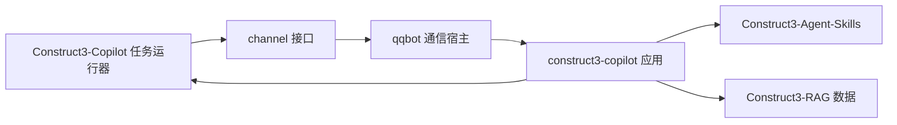

# 运行框架与 QQ 通道

Construct3-Copilot 提供任务运行器和 Construct 应用。QQbot 提供 QQ 通道与可装载应用的运行环境。

图中的两处 Copilot 属于同一个仓库：运行器负责会话、任务、资源锁和执行记录；Construct 应用负责模型工具循环、工程解析、生成和交付规则。

QQbot 的 `plugins/construct3/` 创建这个应用，并注入模型客户端、安装位置及数据目录。
宿主通过 `handle(request)` 传入消息，通过返回值发送回复与文件。
其他应用可以实现同一接口，并自行选择模型、工作流及工具。

| 边界 | 传递内容 |
|---|---|
| QQ → 应用 | `text`、`session_id`、`session_dir`、`history`、`group`、`attachments`、`notify` |
| 应用 → QQ | `text`、`files`、`trace` |
| 应用 → 运行器 | 会话、父任务、工程目录、技能参数 |
| 运行器 → Agent-Skills | 脚本、参数、截止时间、执行环境 |
| Agent-Skills → 运行器 | 退出码、输出、失败原因、生成文件 |

`channel` 是通信边界。当前 QQ 通道使用本机 Python 应用接口，由 QQbot 维护 WebSocket 连接。
QQbot 根目录的 `start.cmd` 打开模型管理页；选择模型后，页面启动或重启连接。

Construct 应用实现在 `copilot/providers/construct3/`。
`Construct3-Agent-Skills` 保存编辑器技能和脚本，`Construct3-RAG` 保存 schema 与知识数据。
QQ 凭据和模型设置保存在 QQbot 的 `.env`，运行数据保存在 `var/`。

离线检查覆盖独立应用的加载、请求上下文、文件结果、任务归属及失败传播。
QQ 连接成功由 `var/runtime/gateway.json` 中的进程身份和 READY 事件确认。
接收方实际看到消息与附件，需要通过真实 QQ 会话另行确认。
